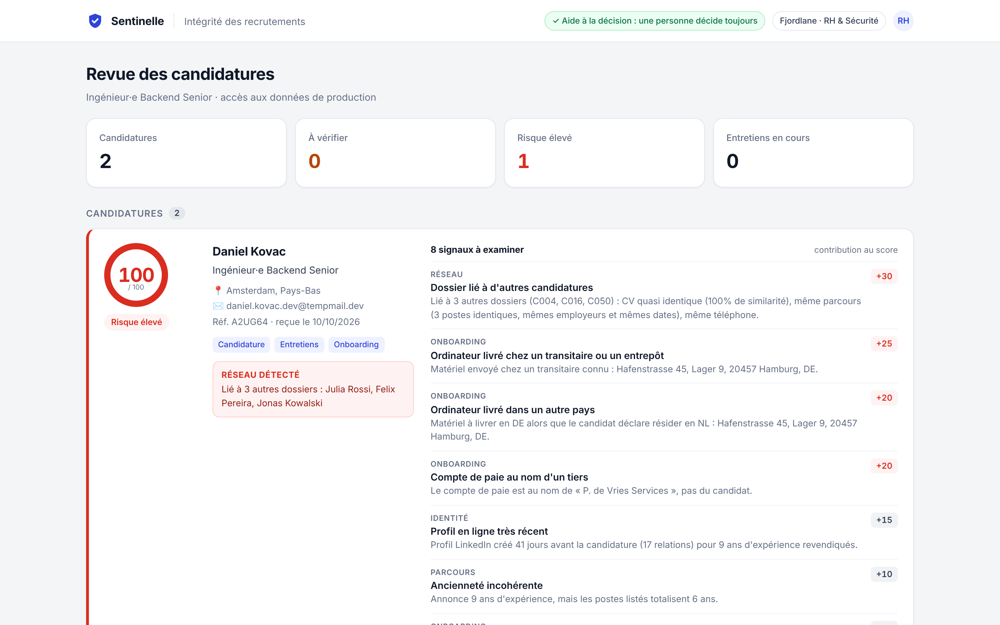

# Sentinelle

Repérer un faux candidat recruté à distance avant qu'il reçoive l'ordinateur et les accès.

Projet du hackathon **Secure Horizons 2026** (ESSEC, Open Track, blue team), par Ludovic et Théophile.

## Le problème

Des opérateurs se font embaucher à distance sous de fausses identités, comme les informaticiens
nord-coréens décrits par le FBI : ils touchent un salaire, volent du code et des données, puis
extorquent l'entreprise une fois découverts. En juin 2025, la justice américaine a perquisitionné
29 fermes d'ordinateurs dans 16 États ; plus de 100 entreprises avaient embauché ces faux salariés.

## Ce que fait Sentinelle

Sentinelle suit le parcours complet du candidat : candidature, entretien, onboarding, premières semaines.

| Brique | Ce qu'elle vérifie | Dossier |
| --- | --- | --- |
| Contrôles de métadonnées (18) | parcours, téléphone, email, profil, livraison du matériel, paie, connexions | `metadata/` |
| Réseaux de personas | dossiers qui partagent un téléphone, un IBAN, un bénéficiaire ou un parcours | `metadata/` |
| Entretien en direct (6 signaux) | caméra ou machine virtuelle, IP d'hébergeur, fuseau, latence | `metadata/live/` |
| Deepfake vidéo | défis devant la caméra, synchronisation des lèvres, éclairage | `video/` (Théophile) |

Le résultat est un score de 0 à 100 où chaque point vient d'un signal précis, avec sa preuve.
Sentinelle ne bloque personne : **le recruteur décide**, et sa décision est inscrite dans un
journal d'audit chaîné par hash. Aucun signal d'origine n'est utilisé (ni nationalité, ni accent,
ni langue) : le téléphone et les connexions sont comparés au pays de **résidence** déclaré.

## Lancer la démo

Python 3.10 ou plus récent, aucune dépendance pour le mode local.

- **Windows** : double-cliquer sur `lancer-demo.bat`. Il ouvre l'offre d'emploi et la console RH.
- **Autres systèmes** : `python -m metadata.live.server`, puis ouvrir
  `http://localhost:8000/apply` (candidat) et `http://localhost:8000/recruiter` (console RH).

Le bouton **Démo** de chaque page remplit un cas honnête (Camille) ou frauduleux (Daniel). Le
déroulé complet, plan par plan, est dans [docs/script-video-demo.md](docs/script-video-demo.md).

Bedrock est optionnel : copier `.env.example` en `.env`, renseigner les clés, mettre
`USE_BEDROCK=1`. Le fichier `.env` n'est jamais commité.

## Résultats

Sur 160 candidatures synthétiques jamais utilisées pour le réglage (44 fraudes, 116 honnêtes) :

| Mesure | Résultat |
| --- | --- |
| Fraudes détectées | 86 % (38 sur 44) |
| Fausses alertes | 0 sur 116 |
| Réseaux de personas retrouvés | 3 sur 3 |
| Temps de calcul | 1,9 ms par dossier, sans GPU |

Ces chiffres sont optimistes : notre équipe a écrit à la fois le jeu de test et le détecteur.
Détails et limites dans [metadata/README.md](metadata/README.md).

## Structure du dépôt

| Dossier | Contenu | Responsable |
| --- | --- | --- |
| `metadata/` | contrôles, réseaux, score, explications, journal d'audit, démo en direct | Ludovic |
| `video/` | détection deepfake ; écrit `video_scores.json` (format en tête de `metadata/video.py`) | Théophile |
| `docs/` | fiche de défense, script de la vidéo, captures | équipe |

Les deux modules ne s'importent pas l'un l'autre : ils communiquent par le fichier `video_scores.json`.

## Livrables du jury

- Fiche de défense (scénario, NIST CSF 2.0, ATT&CK, ATLAS, OWASP, métriques) : [docs/fiche-de-defense.md](docs/fiche-de-defense.md)
- Script de la vidéo de démo : [docs/script-video-demo.md](docs/script-video-demo.md)
- Pitch de 8 slides : à exporter en PDF dans `docs/`

## Règles respectées

- Données 100 % synthétiques : aucun nom, numéro, email ou IBAN réel.
- Aucun secret dans le dépôt : les clés restent dans un `.env` local, ignoré par git.
