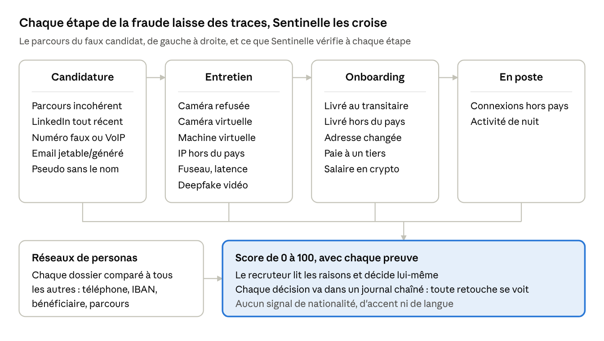

# Fiche de défense · Sentinelle

Secure Horizons 2026 · Open Track · 10 octobre 2026 · Ludovic et Théophile

## Scénario de menace

Un opérateur se fait embaucher à distance sous une fausse identité pour toucher un salaire et accéder aux données. La cible : toute entreprise qui recrute en remote un profil tech ou un poste qui touche des données sensibles.

1. **Candidature** : identité fabriquée (CV recyclé, LinkedIn créé il y a quelques semaines, numéro VoIP). Un même opérateur porte plusieurs identités.
2. **Entretien** : visage échangé ou tiers devant la caméra, connexion relayée par VPN ou bureau à distance.
3. **Embauche** : l'ordinateur part chez un réexpéditeur (« ferme d'ordinateurs »), le salaire vers un tiers ou en crypto.
4. **En poste** : connexions depuis l'étranger, copie des dépôts de code, puis extorsion une fois découvert ([FBI, janvier 2025](https://www.ic3.gov/psa/2025/psa250123)).

**Ampleur.** En juin 2025, le DOJ a visé 29 fermes d'ordinateurs dans 16 États américains ; plus de 100 entreprises avaient embauché ces faux salariés ([DOJ](https://www.justice.gov/opa/pr/justice-department-announces-coordinated-nationwide-actions-combat-north-korean-remote)). Gartner prévoit qu'en 2028, un profil de candidat sur quatre dans le monde sera faux ([Gartner via Greenhouse](https://www.greenhouse.com/de/guidance/mitigate-rising-candidate-fraud-through-identity-verification)). **Impacts** : vol de code et de données, extorsion, et violation des sanctions pour l'employeur qui paie le salaire.

## Notre défense

Sentinelle ne cherche pas une preuve unique : elle croise **18 contrôles de métadonnées** (parcours, coordonnées, livraison, paie, connexions), **6 signaux pris pendant l'entretien en direct** et les **5 scores du module vidéo deepfake**, puis compare chaque dossier à tous les autres pour faire apparaître les réseaux de personas. Chaque signal a un poids et une preuve lisible ; un dossier est signalé à 25 points et prioritaire à 50. Un honnête avec une seule bizarrerie (VPN d'entreprise, expatrié qui garde son numéro) reste sous le seuil : sur le jeu de test, aucun honnête ne dépasse 20.

Sentinelle ne bloque ni ne refuse personne. Elle donne au recruteur 3 à 4 questions de vérification adaptées aux signaux trouvés, et c'est lui qui décide. Le résumé est rédigé par Claude sur Amazon Bedrock après masquage des emails, IBAN et téléphones ; sans AWS, un gabarit local prend le relais.

## Fonctions NIST CSF 2.0

Sentinelle couvre cinq des six fonctions ; la reprise après incident reste aux outils d'identité et d'accès de l'entreprise.

| Fonction | Sous-catégorie | Ce que fait Sentinelle |
| --- | --- | --- |
| Govern | GV.RR-04 Cybersécurité intégrée aux pratiques RH | Le contrôle fait partie du parcours de recrutement, de la candidature à l'onboarding |
| Identify | ID.RA-03 Menaces internes et externes identifiées | Scénario « faux salarié à distance », listes de référence (réexpéditeurs, plages VoIP, domaines jetables) |
| Protect | PR.AA-02 Identités vérifiées avant d'être liées à des accès | Score avant la remise de l'ordinateur et des accès, questions de vérification ciblées |
| Detect | DE.AE-03 Informations corrélées entre sources | Réseaux de personas : téléphone, IBAN, bénéficiaire ou parcours partagés entre dossiers |
| Detect | DE.CM-03 Activité du personnel surveillée | Entretien mesuré toutes les 5 s ; connexions des premières semaines (pays, horaires) |
| Respond | RS.AN-03, RS.AN-06 Analyse, actions traçées et intègres | Preuve lisible par signal ; décision humaine signée dans un journal chaîné par hash |
| Respond | RS.MI-01 Incident contenu | Vérifier, escalader ou refuser avant le premier jour, donc avant tout accès |

## ATT&CK, ATLAS et OWASP

Chaque technique de l'attaquant est reliée au contrôle qui la rend visible ; le code ATT&CK est écrit dans chaque signal et dans le journal d'audit.

| Référentiel | Technique de l'attaquant | Contrôle Sentinelle |
| --- | --- | --- |
| ATT&CK | T1585 / T1585.001 Création de comptes et de profils | Profil récent (C3), URL LinkedIn sans le nom (C17), téléphone invalide ou VoIP (C12, C13), réseau de personas (S1) |
| ATT&CK | T1656 Usurpation d'identité | Caméra refusée (C4), caméra ou micro virtuel (I1), module deepfake |
| ATT&CK | T1090 Proxy | IP d'hébergeur ou d'un autre pays (I4), temps de réponse lointain (I5) |
| ATT&CK | T1564.006 Machine virtuelle | Rendu graphique logiciel ou de VM (I3) |
| ATT&CK | T1078 Comptes valides utilisés à distance | Connexions hors du pays déclaré (C7), activité de nuit (C8) |
| ATLAS | AML.T0088 Générer des deepfakes | Défis vidéo, synchronisation des lèvres, éclairage (module de Théophile, V1 à V5) |
| ATLAS | AML.T0015 Contourner un modèle | 18 contrôles indépendants et un graphe entre dossiers : tromper un contrôle ne suffit pas |
| ATLAS / OWASP | AML.T0051, LLM01 Injection de prompt (CV piégé) | Le score est calculé par des règles ; le LLM ne fait que reformuler les signaux |
| OWASP | LLM02 Fuite d'informations | L'explication ne reçoit que les signaux, jamais l'identité ni le CV |
| OWASP | LLM06 Autonomie excessive | Aucune action automatique : une personne valide, vérifie, escalade ou refuse |

## Métriques

Sur 160 candidats jamais utilisés pour le réglage, Sentinelle détecte 86 % des fraudes sans aucune fausse alerte, contre 61 % et 6 fausses alertes avant nos derniers contrôles.

| Mesure (jeu de test, 44 fraudes, 116 honnêtes) | Avant (11 contrôles) | Après (18 contrôles) |
| --- | --- | --- |
| Fraudes détectées (score ≥ 25) | 61 % (27/44) | **86 % (38/44)** |
| Fausses alertes | 5,2 % (6/116) | **0 % (0/116)** |
| Précision | 0,82 | **1,00** |
| Réseaux de personas retrouvés | 2/3 | **3/3** |
| Temps de détection par dossier | 1,7 ms | 1,9 ms |

- **Par type de fraude (test)** : fermes d'ordinateurs 8/8, mules de paie 7/7, opérateurs à distance 6/6, membres de réseaux 11/11, coordonnées fabriquées 6/7. Les 5 fraudes « subtiles » à un seul signal faible sont manquées, c'est voulu.
- **Temps de détection** : 0,3 s pour 160 dossiers sur un portable ; en entretien, une mesure toutes les 5 s, donc une alerte en moins de 5 s après l'activation d'un VPN ou d'une caméra virtuelle.
- **Temps de réponse** : le score est recalculé à chaque étape (candidature, entretien, onboarding), donc la décision tombe avant l'envoi de l'ordinateur et l'ouverture des accès.
- **Jeu historique** (50 dossiers) : fausses alertes de 10 % à 3,3 %, détection stable à 90 %.

## Éthique et conformité

Sentinelle compare ce que le candidat déclare à ce qu'on observe ; elle ne juge jamais qui il est.

- **Aucun signal d'origine** : ni nationalité, ni accent, ni langue du système. Le téléphone, les connexions et la livraison sont comparés au pays de **résidence déclaré**, et tous les pays pèsent pareil. Le pays de l'IBAN n'est pas regardé (le règlement SEPA interdit de refuser un IBAN étranger).
- **AI Act** : un outil de tri des candidatures est à haut risque (annexe III, point 4). Une personne décide toujours, chaque score est expliqué signal par signal, le candidat est informé de ce qui est mesuré avant de postuler et avant l'entretien.
- **RGPD** : données 100 % synthétiques ; mesures d'entretien non conservées après l'appel ; preuves masquées (email, numéro, IBAN, noms, adresses) avant tout envoi au LLM.
- **Signaux faibles pondérés** : un expatrié qui garde son numéro, un VPN d'entreprise ou un email pseudonyme ne suffisent jamais seuls à lever une alerte.

## Limites et suite

Les chiffres sont optimistes : notre équipe a écrit à la fois le détecteur et le jeu de test, faute de base publique de faux candidats.

- **Jeu de test** : synthétique, et dev et test sortent du même générateur. Prochaine étape : un jeu écrit par quelqu'un qui n'a jamais vu le code, puis un pilote sur de vraies candidatures avec accord.
- **Fraudes subtiles** : un seul signal faible passe sous le seuil, par choix, pour ne pas punir les honnêtes.
- **CV reformulés** : reliés par le parcours (mêmes employeurs, mêmes dates). Un réseau qui change aussi les dates passerait ; c'est le rôle des embeddings Bedrock, à mesurer.
- **Listes de référence** : échantillons (réexpéditeurs, plages VoIP). En production : API de type de ligne téléphonique, liste conformité tenue à jour.
- **Vidéo** : les scores deepfake du jeu sont simulés en attendant le module de Théophile, branché par un fichier `video_scores.json`.
- **Poids fixés à la main**, pas appris.

**Sources** : [FBI IC3, PSA du 23 janvier 2025](https://www.ic3.gov/psa/2025/psa250123) · [DOJ, 30 juin 2025](https://www.justice.gov/opa/pr/justice-department-announces-coordinated-nationwide-actions-combat-north-korean-remote) · [Gartner, avril 2025 (via Greenhouse)](https://www.greenhouse.com/de/guidance/mitigate-rising-candidate-fraud-through-identity-verification) · [MITRE ATLAS AML.T0088](https://d3fend.mitre.org/offensive-technique/attack/AML.T0088/)
